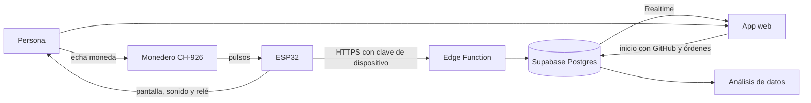

# Alcancía inteligente de colones

Proyecto del curso Interacción Persona-Máquina. Una alcancía con ESP32 que reconoce cada moneda costarricense con un monedero programable, la guarda y muestra el saldo en el teléfono desde cualquier lugar.

**App:** <https://sklinderton.github.io/alcancia-colones/>

## Problema

Una alcancía normal es una caja negra: no sabes cuánto tienes hasta abrirla y contarla. Eso le quita visibilidad a la meta de ahorro.

## Solución

- **Interacción tangible:** echas una moneda y la alcancía confirma al instante con pantalla, sonido y luz. No hay botones ni pasos previos.
- **Prevención de errores:** lo que el monedero no reconoce sale por la devolución en lugar de contarse mal.
- **Visibilidad del estado:** la app muestra saldo, meta y monedas por denominación en vivo.
- **Análisis de datos:** cada movimiento queda guardado en la nube, y la app lo convierte en gráficos de cómo crece el ahorro, cuándo se llega a la meta y cuándo se ahorra más.
- **Control de retiros:** la cerradura se abre desde la app y el retiro se registra para que el saldo siga siendo correcto.

Acepta las monedas en circulación: ₡10, ₡25, ₡50, ₡100 y ₡500.

## Arquitectura



1. El monedero reconoce la moneda, la deja caer a la alcancía y envía una cantidad de pulsos según su valor. El ESP32 cuenta los pulsos y sabe cuál moneda fue.
2. El evento entra a una cola local y se envía a la Edge Function `dispositivo`. Si no hay internet, se reintenta; el id de cada evento evita duplicados.
3. Postgres guarda el evento y calcula el saldo. Las políticas RLS limitan cada alcancía a su propietario.
4. La app recibe el cambio en vivo. Sus órdenes, como abrir, llegan al ESP32 en la siguiente sincronización.
5. La app analiza el historial de eventos (ver abajo).

## Estructura

| Carpeta | Contenido |
|---|---|
| `alcancia-wokwi/` | Firmware y circuito de Wokwi |
| `alcancia-nube/` | Base de datos, Edge Function y pruebas |
| `alcancia-app/` | App web instalable |

## Probar el circuito en Wokwi

Crea un proyecto ESP32 en [Wokwi](https://wokwi.com/projects/new/esp32) y copia `sketch.ino`, `diagram.json` y `libraries.txt`.

Wokwi no tiene monedero, así que el ESP32 hace de monedero: cada botón de moneda genera en el GPIO 17 los mismos pulsos que enviaría el CH-926, y un cable los lleva al GPIO 16. Así se prueba el mismo código que cuenta los pulsos en el hardware real. En el circuito:

- El LED amarillo **Pulsos** parpadea con cada pulso: 1 para ₡10, 2 para ₡25, 3 para ₡50, 4 para ₡100 y 5 para ₡500.
- El botón **Moneda devuelta** representa el sensor IR de la salida de rechazo.
- El LED blanco **Monedero 12 V** muestra el relé que alimenta el monedero. Se apaga si la cola de eventos se llena sin internet, y entonces las monedas salen por la devolución.

El dispositivo final no tiene esos botones.

## Monedero programable

El peso y la densidad de una misma moneda cambian según el año de acuñación, así que pesarla no alcanza para distinguirla. Por eso el diseño usa un monedero programable tipo CH-926, el mismo de las máquinas de peluches. El monedero mide cada moneda al pasar y se entrena con muestras reales, así que se le pueden enseñar monedas de varios años.

| Canal | Moneda | Pulsos |
|---|---|---|
| A | ₡10 | 1 |
| B | ₡25 | 2 |
| C | ₡50 | 3 |
| D | ₡100 | 4 |
| E | ₡500 | 5 |
| F | Libre | 6 |

- Entrena cada canal con unas 20 monedas de años distintos. Si una denominación tiene emisiones muy diferentes, entrena el canal F con la otra emisión y agrega `{6, índice}` a `CANALES` en `sketch.ino`.
- Configura los pulsos en modo medio (50 ms) y la salida en NO.
- Revisa que el diámetro de la ₡500 quepa en el rango del monedero.

## Configurar el dispositivo real

Copia `alcancia-wokwi/secretos.ejemplo.h` como `secretos.h` y complétalo. Ese archivo está excluido del repositorio. En `sketch.ino` cambia `MODO_SIMULACION` a `false`.

| Componente | Conexión |
|---|---|
| Monedero programable CH-926 (6 monedas, 12 V) | Salida COIN → optoacoplador PC817 → GPIO 16 |
| Fuente de 12 V, 2 A | Monedero y cerradura |
| Convertidor reductor de 12 V a 5 V (LM2596 o MP1584) | Alimenta el ESP32 |
| Módulo de relé de 2 canales | Canal 1: cerradura (GPIO 23). Canal 2: alimentación del monedero (GPIO 18) |
| Cerradura solenoide de 12 V | Relé canal 1 |
| Sensor IR FC-51 en la salida de rechazo | GPIO 34 |
| Pantalla OLED SSD1306 | SDA GPIO 21, SCL GPIO 22 |
| Buzzer pasivo | GPIO 19 |
| LED verde y LED rojo con resistencias de 220 Ω | GPIO 13 y GPIO 5 |

El optoacoplador separa la salida del monedero, que trabaja a 12 V, de los 3,3 V del ESP32. En estos monederos la compuerta queda del lado de la devolución cuando no tienen alimentación; hay que confirmarlo con el modelo que se consiga.

## Análisis de datos

La tabla `eventos` de Supabase guarda cada depósito, moneda devuelta, apertura y retiro con su denominación, cantidad, fecha y origen. La app carga ese historial y calcula en [`analisis.js`](alcancia-app/analisis.js):

| Análisis | Qué muestra |
|---|---|
| Ahorro en el tiempo | Saldo al cierre de cada día y la línea de la meta |
| Proyección a la meta | Fecha estimada según el ahorro neto de las últimas 4 semanas, punteada en el gráfico |
| Cuándo ahorras | Monedas por día de la semana y la hora con más depósitos |
| Depósitos y retiros | Total depositado, total retirado y qué porcentaje se sacó |
| Monedas devueltas | Porcentaje que rechaza el monedero; arriba del 5 % sugiere volver a entrenarlo |

Sin `url` en `config.js` la app abre en modo demostración con ocho semanas de datos de ejemplo.

## Publicar la app

La app se sirve desde la rama `gh-pages`. Para actualizarla:

```bash
git subtree push --prefix alcancia-app origin gh-pages
```

## Seguridad

- La clave pública de `config.js` puede estar en el repositorio: las políticas RLS protegen los datos.
- El ESP32 no tiene la clave de servicio; usa una clave propia, guardada como hash.
- Las órdenes de apertura caducan al minuto.

## Estado actual

- Probado: las 12 pruebas de la nube y una moneda enviada desde Wokwi hasta Supabase.
- Firmware con monedero: probado en Wokwi. Las 5 monedas generan sus pulsos (1 a 5) y se registran bien, igual que la moneda devuelta y la apertura. Falta probarlo con un CH-926 real.
- Riesgo a medir con el monedero real: si dos monedas entran con menos de 300 ms entre sus pulsos, el ESP32 las suma como una sola (por ejemplo, ₡10 y ₡100 darían 5 pulsos, que es ₡500).
- Sin probar: el entrenamiento del monedero con monedas de distintos años y el sensor IR de la devolución.
- Análisis: los cálculos tienen pruebas con datos conocidos y los gráficos se revisaron en modo demostración; falta verlos con datos reales.
- Pendiente: validar el certificado en el ESP32, guardar la cola en memoria persistente y recolectar datos reales para el análisis.
