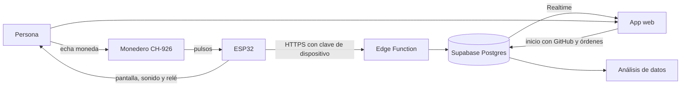

# Alcancía inteligente de colones

Proyecto del curso Interacción Persona-Máquina. Una alcancía con ESP32 que reconoce cada moneda y billete costarricense, lo guarda y muestra el saldo en el teléfono desde cualquier lugar, para que el efectivo deje de ser dinero olvidado.

**App:** <https://sklinderton.github.io/alcancia-colones/>

## Justificación desde IPM

### Problema

El proyecto nace de un problema propio. Cuando pago en efectivo, el vuelto llega en monedas, y esas monedas terminan sueltas en la mesa del cuarto o dentro de una alcancía. En los dos casos pasa lo mismo: **no sé cuánto dinero tengo**.

Lo único que se puede hacer es levantar la alcancía y sentir que pesa, pero el peso engaña porque no dice qué monedas hay. Con los pesos de las monedas usados en el proyecto, un kilo de monedas de ₡10 son unas 410 monedas, cerca de **₡4100**; un kilo de monedas de ₡500 son unas 95, cerca de **₡47 600**. La misma alcancía "pesada" puede valer casi doce veces más o menos según las monedas que tenga.

### Contexto

Hoy casi todo se paga de forma electrónica, con SINPE Móvil o tarjeta, y en esos pagos el banco muestra el saldo y cada movimiento al instante. El efectivo quedó de lado: se usa menos, incomoda más y, sobre todo, es el único dinero del que **no hay ningún registro**. Las monedas del vuelto se vuelven plata olvidada. La alcancía le da al efectivo la misma visibilidad que ya tiene el dinero digital.

### Usuario objetivo

Cualquier persona que todavía recibe vuelto en efectivo, no solo estudiantes universitarios: personas que trabajan, familias que ahorran en monedas o quien quiera juntar para una meta concreta. No hace falta saber de tecnología: se usa igual que una alcancía normal. El primer usuario es el autor, un estudiante universitario que acumula monedas sin saber cuánto suman.

### Diseño de la interfaz

| Decisión de diseño | Principio de IPM |
|---|---|
| Se echa la moneda o el billete como siempre, sin botones ni pasos previos | Interacción tangible: no cambia un hábito que la persona ya tiene |
| Pantalla, sonido y luz confirman al instante cuánto entró y el total | Retroalimentación inmediata y visibilidad del estado del sistema |
| Lo que el monedero no reconoce sale por la devolución; si no se puede registrar, los lectores se apagan | Prevención de errores: mejor devolver que contar mal |
| La app muestra saldo, meta, desglose por denominación y movimientos, como la app de un banco | Consistencia con un modelo mental conocido |
| Monedas y billetes se reconocen por su forma y su valor en pantalla | Reconocimiento antes que recuerdo |
| "Hacer retiro" registra lo que se saca y abre la cerradura en un solo paso | Eficiencia y control del usuario |
| La meta se cambia cuando se quiera y el ahorro puede pasarla | Libertad y control del usuario |
| Gráficos de cuándo se ahorra y cuándo se llegará a la meta | Convertir los datos en información útil para decidir |

### Ventajas frente a otras soluciones

| Solución | Limitación | Esta alcancía |
|---|---|---|
| Dejar las monedas en la mesa | Se pierden y no se sabe cuánto hay | Todo queda guardado y contado |
| Alcancía tradicional | Hay que romperla o vaciarla para contar | El saldo se ve en el teléfono en todo momento |
| Pesar la alcancía | El peso no dice el valor | Cuenta cada denominación por separado |
| Contar a mano | Lento y con errores | Cuenta automáticamente al entrar |
| Anotar en una app de presupuesto | Depende de acordarse de anotar, y se abandona | El registro es automático |
| Alcancía contadora con pantalla | Muestra un total, pero sin historial ni acceso remoto | Historial en la nube, acceso desde cualquier lugar y análisis |

Acepta las monedas en circulación (₡10, ₡25, ₡50, ₡100 y ₡500) y los billetes de ₡1000, ₡2000, ₡5000, ₡10 000 y ₡20 000.

## Arquitectura



1. El monedero reconoce la moneda, la deja caer a la alcancía y envía una cantidad de pulsos según su valor. El ESP32 cuenta los pulsos y sabe cuál moneda fue.
2. El evento entra a una cola local y se envía a la Edge Function `dispositivo`. Si no hay internet, se reintenta; el id de cada evento evita duplicados.
3. Postgres guarda el evento y calcula el saldo. Las políticas RLS limitan cada alcancía a su propietario.
4. La app recibe el cambio en vivo. Sus órdenes, como abrir, llegan al ESP32 en la siguiente sincronización.
5. La app analiza el historial de eventos (ver abajo).

## Estructura

| Carpeta | Contenido |
|---|---|
| `alcancia-wokwi/` | Firmware y circuito de Wokwi |
| `alcancia-nube/` | Base de datos, Edge Function y pruebas |
| `alcancia-app/` | App web instalable |
| `alcancia-analisis/` | Cuaderno de análisis de datos y descarga de la base de datos |

## Probar el circuito en Wokwi

Crea un proyecto ESP32 en [Wokwi](https://wokwi.com/projects/new/esp32) y copia `sketch.ino`, `diagram.json` y `libraries.txt`.

Wokwi no tiene monedero ni lector de billetes, así que el ESP32 hace de los dos: cada botón genera los mismos pulsos que enviaría el lector real, y un cable los lleva de vuelta a la entrada que los cuenta. Así se prueba el mismo código que en el hardware real. En el circuito:

- Botones de **moneda**: pulsos del GPIO 17 al GPIO 16. El LED amarillo **Pulsos monedas** parpadea 1 vez para ₡10, 2 para ₡25, 3 para ₡50, 4 para ₡100 y 5 para ₡500.
- Botones azules de **billete**: pulsos del GPIO 2 al GPIO 39, 1 por cada ₡1000. El LED azul **Pulsos billetes** parpadea 1 vez para ₡1000 y 20 para ₡20 000.
- El botón **Moneda devuelta** representa el sensor IR de la salida de rechazo.
- El LED blanco **Lectores 12 V** muestra el relé que alimenta el monedero y el lector de billetes. Se apaga si la cola de eventos se llena sin internet, y entonces lo que entra sale por la devolución.
- La cerradura (LED naranja) se abre desde la app con **Hacer retiro**.

Echa una moneda o un billete a la vez y espera a que se apague el LED verde.

El dispositivo final no tiene esos botones.

## Monedero programable

El peso y la densidad de una misma moneda cambian según el año de acuñación, así que pesarla no alcanza para distinguirla. Por eso el diseño usa un monedero programable tipo CH-926, el mismo de las máquinas de peluches. El monedero mide cada moneda al pasar y se entrena con muestras reales, así que se le pueden enseñar monedas de varios años.

| Canal | Moneda | Pulsos |
|---|---|---|
| A | ₡10 | 1 |
| B | ₡25 | 2 |
| C | ₡50 | 3 |
| D | ₡100 | 4 |
| E | ₡500 | 5 |
| F | Libre | 6 |

- Entrena cada canal con unas 20 monedas de años distintos. Si una denominación tiene emisiones muy diferentes, entrena el canal F con la otra emisión y agrega `{6, índice}` a `CANALES` en `sketch.ino`.
- Configura los pulsos en modo medio (50 ms) y la salida en NO.
- Revisa que el diámetro de la ₡500 quepa en el rango del monedero.

## Lector de billetes

Los billetes entran por un lector (validador) de billetes con salida de pulsos, configurado para enviar 1 pulso por cada ₡1000: 1 para ₡1000, 2 para ₡2000, 5 para ₡5000, 10 para ₡10 000 y 20 para ₡20 000. El firmware los cuenta en una línea aparte de la del monedero.

El lector tiene que reconocer colones. Los lectores genéricos traen otras monedas de fábrica y algunos permiten cargar o entrenar billetes nuevos; hay que confirmarlo con el modelo que se consiga. Mientras tanto, los billetes se prueban en Wokwi.

## Configurar el dispositivo real

Copia `alcancia-wokwi/secretos.ejemplo.h` como `secretos.h` y complétalo. Ese archivo está excluido del repositorio. En `sketch.ino` cambia `MODO_SIMULACION` a `false`.

| Componente | Conexión |
|---|---|
| Monedero programable CH-926 (6 monedas, 12 V) | Salida COIN → optoacoplador PC817 → GPIO 16 |
| Lector de billetes con salida de pulsos (12 V) | Salida de pulsos → optoacoplador PC817 → GPIO 39 |
| Fuente de 12 V, 3 A | Monedero, lector de billetes y cerradura |
| Convertidor reductor de 12 V a 5 V (LM2596 o MP1584) | Alimenta el ESP32 |
| Módulo de relé de 2 canales | Canal 1: cerradura (GPIO 23). Canal 2: alimentación del monedero y del lector de billetes (GPIO 18) |
| Cerradura solenoide de 12 V | Relé canal 1 |
| Sensor IR FC-51 en la salida de rechazo | GPIO 34 |
| Pantalla OLED SSD1306 | SDA GPIO 21, SCL GPIO 22 |
| Buzzer pasivo | GPIO 19 |
| LED verde y LED rojo con resistencias de 220 Ω | GPIO 13 y GPIO 5 |

El optoacoplador separa la salida del monedero, que trabaja a 12 V, de los 3,3 V del ESP32. En estos monederos la compuerta queda del lado de la devolución cuando no tienen alimentación; hay que confirmarlo con el modelo que se consiga.

## Análisis de datos

La tabla `eventos` de Supabase guarda cada depósito, moneda devuelta, apertura y retiro con su denominación, cantidad, fecha y origen. La app carga ese historial y calcula en [`analisis.js`](alcancia-app/analisis.js):

| Análisis | Qué muestra |
|---|---|
| Ahorro en el tiempo | Saldo al cierre de cada día y la línea de la meta |
| Proyección a la meta | Fecha estimada según el ahorro neto de las últimas 4 semanas, punteada en el gráfico |
| Cuándo ahorras | Monedas por día de la semana y la hora con más depósitos |
| Depósitos y retiros | Total depositado, total retirado y qué porcentaje se sacó |
| Monedas devueltas | Porcentaje que rechaza el monedero; arriba del 5 % sugiere volver a entrenarlo |

Sin `url` en `config.js` la app abre en modo demostración con ocho semanas de datos de ejemplo.

Además, la carpeta [`alcancia-analisis/`](alcancia-analisis/) tiene un cuaderno de Python que descarga los eventos de Supabase y responde la pregunta del proyecto: *¿cuánto efectivo acumula una persona sin darse cuenta, cuándo lo ahorra y qué tan rápido llega a su meta?* Usa una simulación Monte Carlo para la fecha de la meta y un modelo de aprendizaje automático (Isolation Forest) para detectar movimientos anómalos.

## Publicar la app

La app se sirve desde la rama `gh-pages`. Para actualizarla:

```bash
git subtree push --prefix alcancia-app origin gh-pages
```

## Mantener la nube activa

El plan gratuito de Supabase pausa el proyecto tras una semana sin uso, y mientras está pausado la app y el ESP32 no pueden conectarse. El workflow [`mantener-supabase.yml`](.github/workflows/mantener-supabase.yml) consulta la base de datos todos los días para evitarlo. Si aun así se pausa, se restaura desde el panel de Supabase con **Restore project**.

## Seguridad

- La clave pública de `config.js` puede estar en el repositorio: las políticas RLS protegen los datos.
- El ESP32 no tiene la clave de servicio; usa una clave propia, guardada como hash.
- Las órdenes de apertura caducan al minuto.

## Estado actual

- Probado: las 13 pruebas de la nube (incluidos los billetes) y monedas enviadas desde Wokwi hasta Supabase.
- Firmware con monedero: probado en Wokwi. Las 5 monedas generan sus pulsos (1 a 5) y se registran bien, igual que la moneda devuelta y la apertura. Falta probarlo con un CH-926 real.
- Billetes: probados en Wokwi hasta Supabase (₡1000 y ₡5000). En la simulación los botones se atienden por interrupción, así no se pierden mientras el ESP32 espera a la nube, y dos toques seguidos se cuentan por separado.
- Riesgo a medir con el monedero real: si dos monedas entran con menos de 300 ms entre sus pulsos, el ESP32 las suma como una sola (por ejemplo, ₡10 y ₡100 darían 5 pulsos, que es ₡500).
- Sin probar: el entrenamiento del monedero con monedas de distintos años y el sensor IR de la devolución.
- Análisis: los cálculos tienen pruebas con datos conocidos y los gráficos se revisaron en modo demostración; falta verlos con datos reales.
- Pendiente: validar el certificado en el ESP32, guardar la cola en memoria persistente y recolectar datos reales para el análisis.
