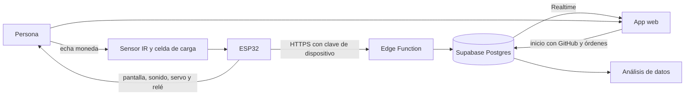

# Alcancía inteligente de colones

Proyecto del curso Interacción Persona-Máquina. Una alcancía con ESP32 que reconoce cada moneda costarricense por su peso, la guarda y muestra el saldo en el teléfono desde cualquier lugar.

**App:** <https://sklinderton.github.io/alcancia-colones/>

## Problema

Una alcancía normal es una caja negra: no sabes cuánto tienes hasta abrirla y contarla. Eso le quita visibilidad a la meta de ahorro.

## Solución

- **Interacción tangible:** echas una moneda y la alcancía confirma al instante con pantalla, sonido y luz. No hay botones ni pasos previos.
- **Prevención de errores:** ante un peso dudoso, la moneda se devuelve en lugar de contarse mal.
- **Visibilidad del estado:** la app muestra saldo, meta y monedas por denominación en vivo.
- **Control de retiros:** la cerradura se abre desde la app y el retiro se registra para que el saldo siga siendo correcto.

Acepta las monedas en circulación: ₡10, ₡25, ₡50, ₡100 y ₡500.

## Arquitectura

1. El ESP32 detecta la moneda, la pesa y la clasifica.
2. El evento entra a una cola local y se envía a la Edge Function `dispositivo`. Si no hay internet, se reintenta; el id de cada evento evita duplicados.
3. Postgres guarda el evento y calcula el saldo. Las políticas RLS limitan cada alcancía a su propietario.
4. La app recibe el cambio en vivo. Sus órdenes, como abrir, llegan al ESP32 en la siguiente sincronización.

## Estructura

| Carpeta | Contenido |
|---|---|
| `alcancia-wokwi/` | Firmware, circuito de Wokwi y prueba del clasificador |
| `alcancia-nube/` | Base de datos, Edge Function y pruebas |
| `alcancia-app/` | App web instalable |

## Probar el circuito en Wokwi

Crea un proyecto ESP32 en [Wokwi](https://wokwi.com/projects/new/esp32) y copia `sketch.ino`, `diagram.json` y `libraries.txt`. Cada botón representa una moneda que cae, porque el simulador no permite soltar una moneda real. El dispositivo final no tiene esos botones.

## Configurar el dispositivo real

Copia `alcancia-wokwi/secretos.ejemplo.h` como `secretos.h` y complétalo. Ese archivo está excluido del repositorio. En `sketch.ino` cambia `MODO_SIMULACION` a `false`.

## Seguridad

- La clave pública de `config.js` puede estar en el repositorio: las políticas RLS protegen los datos.
- El ESP32 no tiene la clave de servicio; usa una clave propia, guardada como hash.
- Las órdenes de apertura caducan al minuto.

## Estado actual

- Probado: las 12 pruebas de la nube y una moneda enviada desde Wokwi hasta Supabase.
- Sin probar: báscula y sensor físicos, y la precisión con monedas reales. El diseño necesita un ruido de báscula de 0,15 g o menos.
- Pendiente: validar el certificado en el ESP32, guardar la cola en memoria persistente y recolectar datos reales para el análisis.
